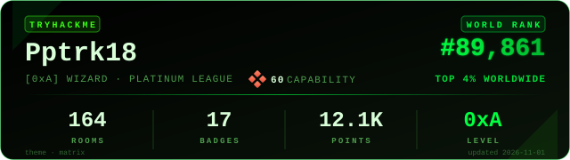

# Cybersecurity-portfolio
I am aspiring Penetration Tester, currently developing my skills in offensive security, ethical hacking and network security. This repository documents my learning journey, practical experience and projects related to cybersecurity. Every day I try to learn and developing my skills by atleast 1%. My goal is to be the best in penetratrions test.
#TryHackMe Stats

